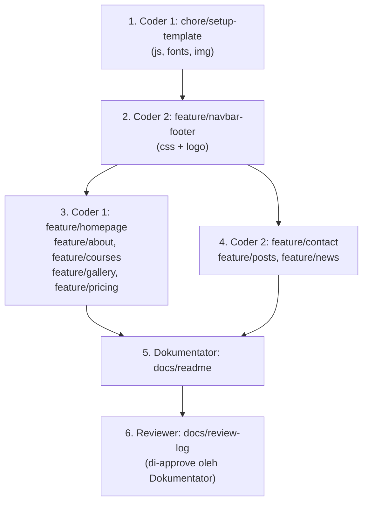

# Mulai Di Sini: Panduan Kerja Tim JendEdu (Git & GitHub untuk Pemula)

Selamat datang! Panduan ini dibuat untuk kamu yang **belum pernah memakai Git**, dan memakai **Windows**. Semua langkah ditulis satu per satu, tinggal ikuti dan salin perintahnya.

## Apa ini?

Tim kalian akan membangun website **JendEdu** (website kursus online SD, SMP, SMA) bersama-sama lewat GitHub.

Ada dua repo (tempat menyimpan proyek):

| Repo | Fungsi | Boleh diubah? |
|------|--------|---------------|
| https://github.com/Borayaa/JendEdu-template | Sumber file jadi (HTML, CSS, gambar, dll). | **Tidak.** Hanya dibaca dan disalin. Jangan edit atau push ke sini. |
| https://github.com/Borayaa/JendEdu | Repo tempat tim bekerja (branch `main`). | Ya, tapi lewat branch dan Pull Request. |

Repo `JendEdu` dimulai dalam keadaan **kosong** (belum ada file). Semua file masuk sedikit demi sedikit lewat Pull Request di bawah.

Caranya: kalian **menyalin file dari template ke JendEdu sedikit demi sedikit**. Setiap potongan kerja dibuat di satu **branch** sendiri, lalu dikirim lewat **Pull Request (PR)**, diperiksa Reviewer, dan baru digabung ke `main`.

## Langkah pertama untuk SEMUA anggota

Baca dan kerjakan dulu: **[01-persiapan-semua-anggota.md](01-persiapan-semua-anggota.md)** (install Git, atur nama, clone repo).

Setelah itu buka panduan sesuai peranmu.

## Peran dan panduannya

| Peran | Username GitHub | Tugas singkat | Panduan |
|-------|-----------------|---------------|---------|
| Coder 1 | @username-1 | Aset template, lalu halaman Beranda, Tentang, Kursus, Galeri, Harga | [02-coder-1.md](02-coder-1.md) |
| Coder 2 | @username-2 | Navbar & footer (CSS), Kontak, 3 Artikel, 3 Berita | [03-coder-2.md](03-coder-2.md) |
| Reviewer | @username-3 | Memeriksa setiap PR, minta perbaikan, approve dan merge | [04-reviewer.md](04-reviewer.md) |
| Dokumentator | @username-4 | README.md dan presentasi (PPTX) | [05-dokumentator.md](05-dokumentator.md) |

Catatan: `@username-1` sampai `@username-4` hanyalah contoh. Ganti dengan username GitHub asli kalian. Pemilik kedua repo adalah **Borayaa**.

## Urutan Pull Request (PENTING!)

Urutan ini tidak boleh dilompati, karena PR berikutnya butuh file dari PR sebelumnya.



Versi teks:

```
1. Coder 1      chore/setup-template        (HARUS PERTAMA, semua menunggu ini ter-merge)
        |
2. Coder 2      feature/navbar-footer       (setelah #1 ter-merge)
        |
   +----+-----------------------------+
   |                                  |
3. Coder 1                          4. Coder 2         (berjalan paralel, setelah #1 dan #2 ter-merge)
   feature/homepage                    feature/contact
   feature/about                       feature/posts
   feature/courses                     feature/news
   feature/gallery
   feature/pricing
   |                                  |
   +----------------+-----------------+
                    |
5. Dokumentator   docs/readme                (setelah situs ter-merge, agar screenshot bisa diambil)
                    |
6. Reviewer       docs/review-log            (paling akhir; di-review oleh Dokumentator)
```

Aturan emas:
- Satu branch = satu Pull Request.
- Jangan pernah mengerjakan langsung di `main`.
- Tidak ada yang meng-approve PR miliknya sendiri.
- Folder `panduan\` (panduan ini) **tidak** disalin ke repo JendEdu.

## Alur kerja singkat (diulang untuk setiap tugas)

1. **Git Bash:** pindah ke `main`, ambil update terbaru, buat branch baru.
2. **Command Prompt:** salin file dari template.
3. **Git Bash:** `git add`, `git commit`, `git push`.
4. **Browser (github.com):** buka Pull Request dan pilih Reviewer.
5. Reviewer memberi komentar, kamu memperbaiki, lalu Reviewer approve dan merge.
6. Semua orang: `git switch main` lalu `git pull origin main`.

Detail lengkapnya ada di panduan peran masing-masing.

## Kamus istilah (bahasa sederhana)

| Istilah | Artinya |
|---------|---------|
| **Repository (repo)** | Folder proyek yang disimpan di GitHub, lengkap dengan riwayat perubahannya. |
| **Clone** | Mengunduh salinan repo dari GitHub ke komputermu. Dilakukan sekali saja. |
| **Branch** | "Cabang" kerja terpisah. Kamu bisa mengubah file di branch tanpa mengganggu `main`. |
| **Commit** | "Simpan" perubahan beserta pesan singkat. Seperti save point di game. |
| **Push** | Mengirim commit dari komputermu ke GitHub. |
| **Pull** | Mengambil perubahan terbaru dari GitHub ke komputermu. |
| **Pull Request (PR)** | Permintaan agar branch-mu digabung ke `main`. Orang lain bisa memeriksanya dulu. |
| **Review** | Pemeriksaan PR oleh teman: membaca, memberi komentar, minta perbaikan. |
| **Approve** | Persetujuan Reviewer bahwa PR sudah bagus. |
| **Merge** | Menggabungkan branch ke `main` setelah PR disetujui. |
| **Collaborator** | Orang yang diberi izin menulis di sebuah repo. |

## Aplikasi apa untuk apa?

| Aplikasi | Dipakai untuk |
|----------|---------------|
| **Command Prompt (cmd)** | Membuat folder, pindah folder (`cd`), **menyalin file** (`copy`, `xcopy`, `robocopy`), membuka situs (`start index.html`). |
| **Git Bash** | **Semua perintah `git`** (clone, switch, add, commit, push, pull). |
| **Browser (github.com)** | Membuat PR, review, approve, merge. |

Folder kerja kita: `C:\Proyek` (di Git Bash ditulis `/c/Proyek`).

## Butuh bantuan?

Kalau ada pesan error, cari bagian "Kalau error..." di panduan yang sedang kamu ikuti, atau bagian troubleshooting di [01-persiapan-semua-anggota.md](01-persiapan-semua-anggota.md). Kalau masih buntu, kirim tangkapan layar error ke grup tim.
